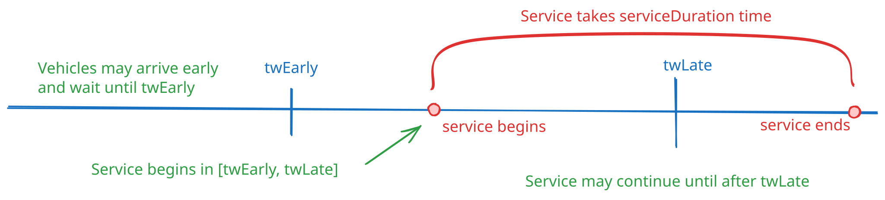
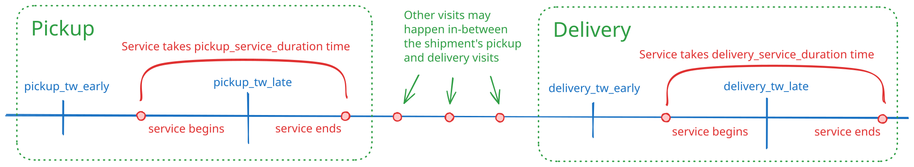
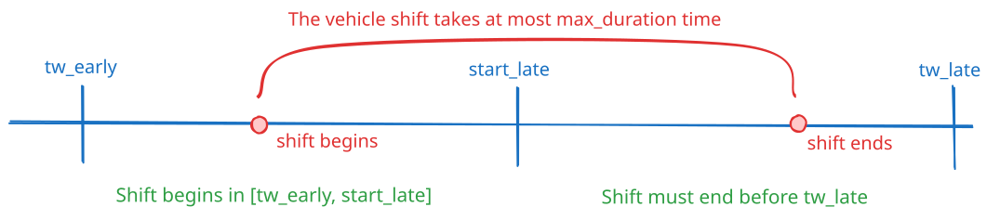

Concepts
========

This page explains how different attributes of PyVRP's data model relate.

Time and duration constraints
-----------------------------

Clients, shipments, depots and vehicles are equipped with time windows, and a number of other time and duration-related attributes.
Together, these attributes can be used to model a rich set of constraints.
Below, we explain the attributes, and how these can be used to enforce different constraints.

Clients
^^^^^^^

In the case of clients modelled using the :class:`~pyvrp._pyvrp.Client` object, the time window indicates when service at the client may *begin*.
Service is allowed to complete after the time window is already closed.
A vehicle may arrive at a client before its time window opens, in which case it waits until the opening of the time window to begin service.
Arriving late, that is, after the client time window closes, is not allowed in a feasible solution.
Service takes a certain duration to complete, after which the vehicle is free to leave the client.
The following figure explains this graphically.

Shipments
^^^^^^^^^

Shipments modelled using :class:`~pyvrp._pyvrp.Shipment` objects support time windows and service durations at both the pickup and delivery location.
The model follows that of clients: the time windows indicate when service may *begin*, but vehicles are allowed to arrive earlier.
The following figure explains the available time window and service duration attributes graphically.

Depots
^^^^^^

Depots modelled using :class:`~pyvrp._pyvrp.Depot` objects support opening hour restrictions through their time window attributes.
The opening hours indicate when vehicles may visit the depot to start, end, or reload along their routes.
As with client time windows, waiting for a depot to open is allowed, but arriving late is not.
The depot's :attr:`~pyvrp._pyvrp.Depot.service_duration` applies to vehicles leaving the depot, and can for example be used to model the time it takes to load the vehicle. 

Vehicles
^^^^^^^^

Vehicles modelled using the :class:`~pyvrp._pyvrp.VehicleType` object support several duration constraints.
In particular, vehicles are equipped with time window attributes limiting the earliest start and latest completion times of a vehicle's assigned route.
Between these two times, a vehicle may execute a route of a given maximum duration.
Additionally, the starting time of the vehicle's assigned route may be further constrained to happen during the beginning of the time window. 
The following figure explains this graphically.

Electric vehicles
-----------------

Vehicles get a battery through the ``battery_capacity`` field of the :class:`~pyvrp._pyvrp.VehicleType` object.
A vehicle starts its route with ``initial_charge`` units of charge, which defaults to a full battery, and drains one unit of charge per unit of distance.
The battery capacity is thus the range of the vehicle in distance units.
Vehicles that drain differently can be modelled with their own routing profile.

Vehicles recharge at chargers, which are modelled using :class:`~pyvrp._pyvrp.Charger` objects.
Each visit to a charger takes the vehicle's ``recharge_duration`` and fully recharges the battery.
Chargers are optional stops that any vehicle may visit as often as needed, so the solver decides which chargers to use.
Unlike reload depots, chargers do not change the load in the vehicle, and do not start a new trip.
Reload depots also do not recharge the battery, but a charger may be added at the same location.

Running out of charge is not allowed in a feasible solution.
During the search, charge that the battery cannot supply counts as excess distance, and is thus penalised in the same way as a violation of the vehicle's ``max_distance``.

In the following example, neither client can be reached without a stop at the charger.

.. code-block:: python

   from pyvrp import Model
   from pyvrp.stop import MaxIterations

   m = Model()
   m.add_depot(location=m.add_location(x=0, y=0))
   m.add_vehicle_type(battery_capacity=70, recharge_duration=10)
   m.add_charger(location=m.add_location(x=50, y=0))

   for x in [40, 60]:
       m.add_client(location=m.add_location(x=x, y=0))

   for frm in m.locations:
       for to in m.locations:
           m.add_edge(frm, to, distance=abs(frm.x - to.x))

   result = m.solve(MaxIterations(100))
